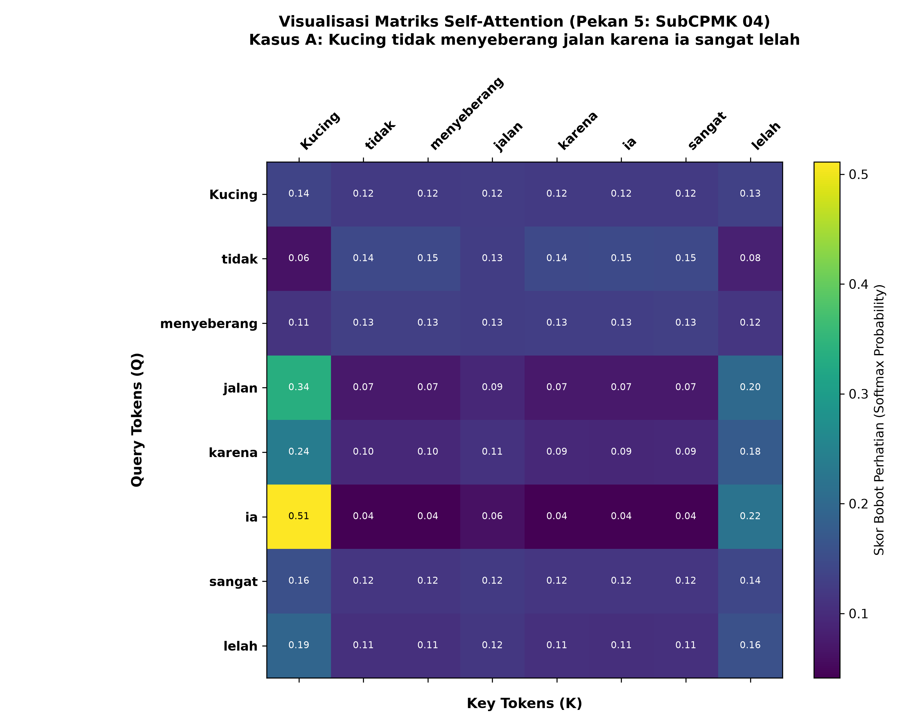
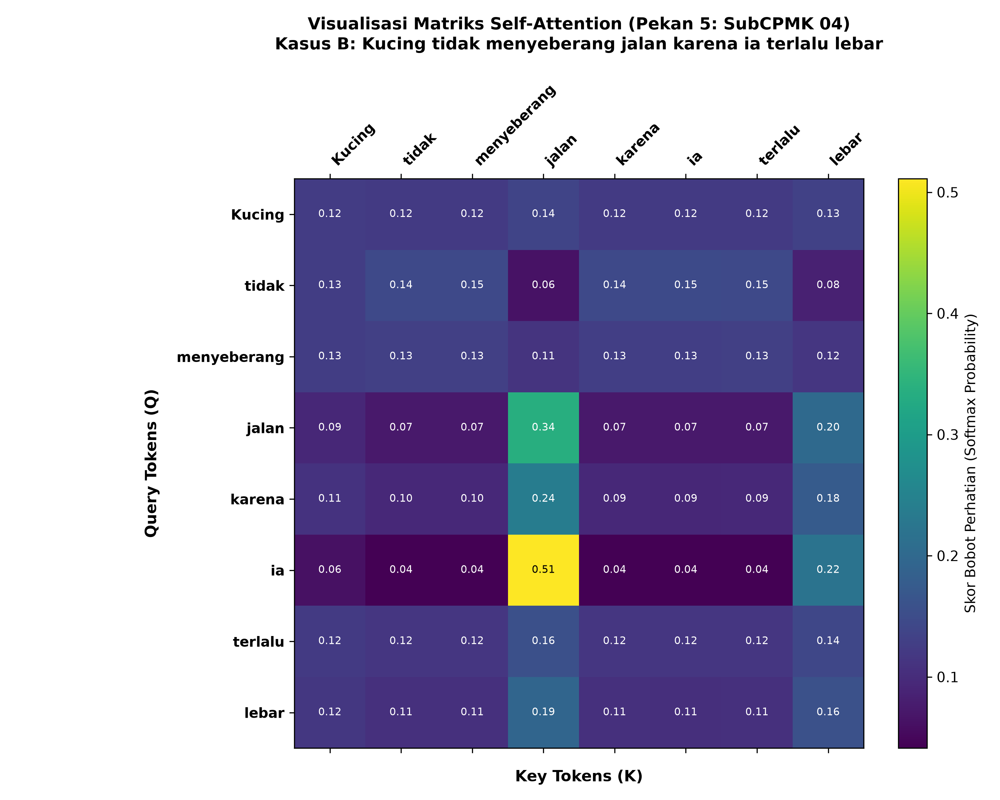

# Lab Pekan 05 - Transformer Modifikasi

Repositori ini berisi kode pemrograman serta hasil visualisasi dari praktikum Transformer modifikasi.

## 📂 Struktur File
* **`lab_pekan_05_transformer_modifikasi.py`** : Skrip utama Python yang digunakan untuk menjalankan model Transformer modifikasi[cite: 1].
* **`attention_heatmap_pekan_05.png`** : Hasil visualisasi *attention heatmap* utama[cite: 1].
* **`attention_heatmap_pekan_05_kasus_B.png`** : Hasil visualisasi *attention heatmap* untuk Kasus B[cite: 1].

---

## 📊 Visualisasi Hasil

### 1. Attention Heatmap (Pekan 05)

### 2. Attention Heatmap (Kasus B)

